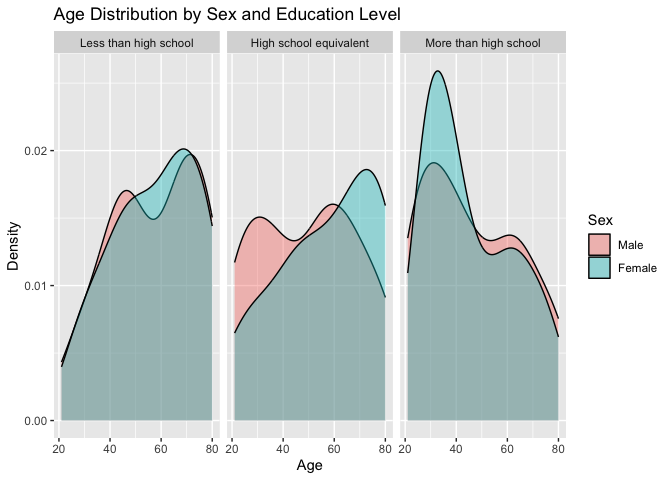
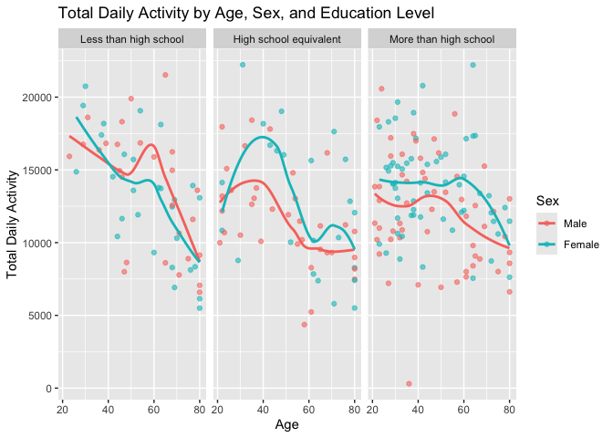
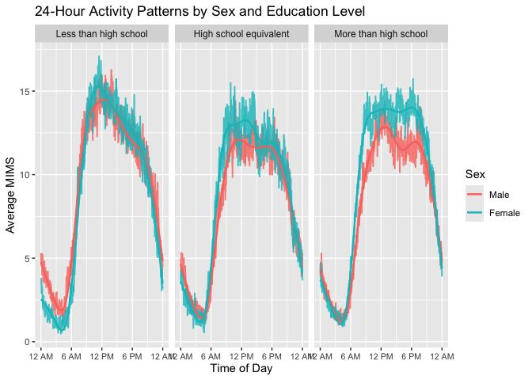
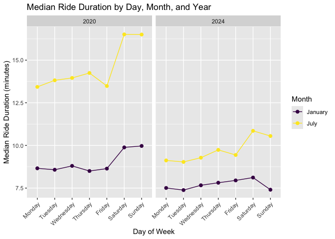
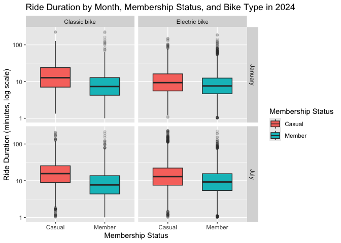

Homework 3
================
Ruichen Yang
2026-10-19

## Problem 1

``` r
data("ny_noaa")

dim(ny_noaa)
```

    ## [1] 2595176       7

``` r
names(ny_noaa)
```

    ## [1] "id"   "date" "prcp" "snow" "snwd" "tmax" "tmin"

``` r
head(ny_noaa)
```

    ## # A tibble: 6 × 7
    ##   id          date        prcp  snow  snwd tmax  tmin 
    ##   <chr>       <date>     <int> <int> <int> <chr> <chr>
    ## 1 US1NYAB0001 2007-11-01    NA    NA    NA <NA>  <NA> 
    ## 2 US1NYAB0001 2007-11-02    NA    NA    NA <NA>  <NA> 
    ## 3 US1NYAB0001 2007-11-03    NA    NA    NA <NA>  <NA> 
    ## 4 US1NYAB0001 2007-11-04    NA    NA    NA <NA>  <NA> 
    ## 5 US1NYAB0001 2007-11-05    NA    NA    NA <NA>  <NA> 
    ## 6 US1NYAB0001 2007-11-06    NA    NA    NA <NA>  <NA>

``` r
ny_noaa_clean = ny_noaa |>
  mutate(
    year = lubridate::year(date),
    month = lubridate::month(date),
    day = lubridate::day(date),
    prcp = prcp / 10,
    tmax = as.numeric(tmax) / 10,
    tmin = as.numeric(tmin) / 10
  )

dim(ny_noaa_clean)
```

    ## [1] 2595176      10

``` r
head(ny_noaa_clean)
```

    ## # A tibble: 6 × 10
    ##   id          date        prcp  snow  snwd  tmax  tmin  year month   day
    ##   <chr>       <date>     <dbl> <int> <int> <dbl> <dbl> <dbl> <dbl> <int>
    ## 1 US1NYAB0001 2007-11-01    NA    NA    NA    NA    NA  2007    11     1
    ## 2 US1NYAB0001 2007-11-02    NA    NA    NA    NA    NA  2007    11     2
    ## 3 US1NYAB0001 2007-11-03    NA    NA    NA    NA    NA  2007    11     3
    ## 4 US1NYAB0001 2007-11-04    NA    NA    NA    NA    NA  2007    11     4
    ## 5 US1NYAB0001 2007-11-05    NA    NA    NA    NA    NA  2007    11     5
    ## 6 US1NYAB0001 2007-11-06    NA    NA    NA    NA    NA  2007    11     6

``` r
missing_summary = ny_noaa_clean |>
  summarize(
    across(
      c(prcp, snow, snwd, tmax, tmin),
      ~ mean(is.na(.))
    )
  )

missing_summary
```

    ## # A tibble: 1 × 5
    ##     prcp  snow  snwd  tmax  tmin
    ##    <dbl> <dbl> <dbl> <dbl> <dbl>
    ## 1 0.0562 0.147 0.228 0.437 0.437

``` r
snow_common = ny_noaa_clean |>
  filter(!is.na(snow)) |>
  count(snow, sort = TRUE)

head(snow_common, 10)
```

    ## # A tibble: 10 × 2
    ##     snow       n
    ##    <int>   <int>
    ##  1     0 2008508
    ##  2    25   31022
    ##  3    13   23095
    ##  4    51   18274
    ##  5    76   10173
    ##  6     8    9962
    ##  7     5    9748
    ##  8    38    9197
    ##  9     3    8790
    ## 10   102    6552

The cleaned NOAA dataset contains 2,595,176 observations. The main
variables include station ID, date, precipitation, snowfall, snow depth,
and daily maximum and minimum temperatures. I also created separate
year, month, and day variables and converted precipitation and
temperature to more interpretable units. Missingness varies across
variables: about 5.6% of precipitation values are missing, compared with
14.7% for snowfall, 22.8% for snow depth, and about 43.7% for both
maximum and minimum temperature. The most common snowfall value is 0 mm,
which makes sense because most station-days do not have snowfall. Other
common values include 25, 13, 51, 76, and 102 mm. These values are close
to common snowfall measurements in inches converted to millimeters, such
as 1, 0.5, 2, 3, and 4 inches.

``` r
temp_month_plot = ny_noaa_clean |>
  filter(month %in% c(1, 7)) |>
  mutate(
    month = recode(
      month,
      `1` = "January",
      `7` = "July"
    )
  ) |>
  group_by(id, year, month) |>
  summarize(
    mean_tmax = mean(tmax, na.rm = TRUE),
    .groups = "drop"
  ) |>
  filter(!is.nan(mean_tmax))

ggplot(
  temp_month_plot,
  aes(x = year, y = mean_tmax, group = id)
) +
  geom_line(alpha = 0.15) +
  facet_grid(. ~ month) +
  labs(
    x = "Year",
    y = "Average Maximum Temperature (°C)",
    title = "Average Maximum Temperature in January and July"
  )
```

<!-- -->

The January and July panels show a clear seasonal difference in average
maximum temperature. January temperatures are much lower and also show
more variability across stations and years, while July temperatures are
generally concentrated around the upper 20s °C. I also notice a few
potential outliers, including unusually low January averages and several
July station-year averages that fall well below the main cluster.

``` r
temp_plot = ny_noaa_clean |>
  filter(!is.na(tmin), !is.na(tmax)) |>
  ggplot(aes(x = tmin, y = tmax)) +
  geom_bin_2d(bins = 40) +
  labs(
    x = "Minimum Temperature (°C)",
    y = "Maximum Temperature (°C)",
    title = "Maximum vs Minimum Temperature"
  )
```

``` r
snow_plot = ny_noaa_clean |>
  filter(
    !is.na(snow),
    snow > 0,
    snow < 100
  ) |>
  ggplot(aes(x = year, y = snow, group = year)) +
  geom_boxplot() +
  scale_x_continuous(breaks = seq(1980, 2010, by = 5)) +
  labs(
    x = "Year",
    y = "Snowfall (mm)",
    title = "Distribution of Snowfall by Year"
  )
```

``` r
temp_plot / snow_plot
```

<!-- -->

Maximum and minimum temperatures have a strong positive relationship,
with most observations following a clear diagonal pattern. For snowfall
values between 0 and 100 mm, the yearly distributions are fairly similar
overall, although a few years have somewhat different spreads and high
outliers.

## Problem 2

``` r
nhanes_accel = read_csv(
  "data/nhanes_accel.csv",
  show_col_types = FALSE
)

nhanes_covar = read_csv(
  "data/nhanes_covar.csv",
  skip = 4,
  show_col_types = FALSE
) |>
  janitor::clean_names()

dim(nhanes_covar)
```

    ## [1] 250   5

``` r
names(nhanes_covar)
```

    ## [1] "seqn"      "sex"       "age"       "bmi"       "education"

``` r
head(nhanes_covar)
```

    ## # A tibble: 6 × 5
    ##    seqn   sex   age   bmi education
    ##   <dbl> <dbl> <dbl> <dbl>     <dbl>
    ## 1 62161     1    22  23.3         2
    ## 2 62164     2    44  23.2         3
    ## 3 62169     1    21  20.1         2
    ## 4 62174     1    80  33.9         3
    ## 5 62177     1    51  20.1         2
    ## 6 62178     1    80  28.5         2

``` r
nhanes_covar_clean = nhanes_covar |>
  filter(age >= 21) |>
  drop_na(sex, age, bmi, education) |>
  mutate(
    sex = factor(
      sex,
      levels = c(1, 2),
      labels = c("Male", "Female")
    ),
    education = factor(
      education,
      levels = c(1, 2, 3),
      labels = c(
        "Less than high school",
        "High school equivalent",
        "More than high school"
      ),
      ordered = TRUE
    )
  )

dim(nhanes_covar_clean)
```

    ## [1] 228   5

``` r
head(nhanes_covar_clean)
```

    ## # A tibble: 6 × 5
    ##    seqn sex      age   bmi education             
    ##   <dbl> <fct>  <dbl> <dbl> <ord>                 
    ## 1 62161 Male      22  23.3 High school equivalent
    ## 2 62164 Female    44  23.2 More than high school 
    ## 3 62169 Male      21  20.1 High school equivalent
    ## 4 62174 Male      80  33.9 More than high school 
    ## 5 62177 Male      51  20.1 High school equivalent
    ## 6 62178 Male      80  28.5 High school equivalent

``` r
table(nhanes_covar_clean$sex)
```

    ## 
    ##   Male Female 
    ##    118    110

``` r
table(nhanes_covar_clean$education)
```

    ## 
    ##  Less than high school High school equivalent  More than high school 
    ##                     55                     58                    115

``` r
nhanes_accel_long = nhanes_accel |>
  pivot_longer(
    cols = starts_with("min"),
    names_to = "minute",
    values_to = "mims"
  ) |>
  mutate(
    minute = parse_number(minute)
  )

dim(nhanes_accel_long)
```

    ## [1] 360000      3

``` r
head(nhanes_accel_long)
```

    ## # A tibble: 6 × 3
    ##    SEQN minute  mims
    ##   <dbl>  <dbl> <dbl>
    ## 1 62161      1 1.11 
    ## 2 62161      2 3.12 
    ## 3 62161      3 1.47 
    ## 4 62161      4 0.938
    ## 5 62161      5 1.60 
    ## 6 62161      6 0.145

``` r
nhanes_clean = nhanes_covar_clean |>
  inner_join(
    nhanes_accel_long,
    by = c("seqn" = "SEQN")
  )

dim(nhanes_clean)
```

    ## [1] 328320      7

``` r
head(nhanes_clean)
```

    ## # A tibble: 6 × 7
    ##    seqn sex     age   bmi education              minute  mims
    ##   <dbl> <fct> <dbl> <dbl> <ord>                   <dbl> <dbl>
    ## 1 62161 Male     22  23.3 High school equivalent      1 1.11 
    ## 2 62161 Male     22  23.3 High school equivalent      2 3.12 
    ## 3 62161 Male     22  23.3 High school equivalent      3 1.47 
    ## 4 62161 Male     22  23.3 High school equivalent      4 0.938
    ## 5 62161 Male     22  23.3 High school equivalent      5 1.60 
    ## 6 62161 Male     22  23.3 High school equivalent      6 0.145

``` r
education_table = nhanes_covar_clean |>
  count(education, sex) |>
  pivot_wider(
    names_from = sex,
    values_from = n,
    values_fill = 0
  )

education_table
```

    ## # A tibble: 3 × 3
    ##   education               Male Female
    ##   <ord>                  <int>  <int>
    ## 1 Less than high school     27     28
    ## 2 High school equivalent    35     23
    ## 3 More than high school     56     59

``` r
ggplot(
  nhanes_covar_clean,
  aes(x = age, fill = sex)
) +
  geom_density(alpha = 0.4) +
  facet_wrap(~ education, nrow = 1) +
  labs(
    x = "Age",
    y = "Density",
    fill = "Sex",
    title = "Age Distribution by Sex and Education Level"
  )
```

<!-- -->

The age distributions differ across education levels and between men and
women. For participants with less than a high school education, the male
and female distributions are fairly similar, with more observations at
older ages. In the high school equivalent group, women appear to be
somewhat older on average than men. Among participants with more than a
high school education, women are more concentrated at younger ages,
while the male distribution is more spread out across the age range.

``` r
total_activity = nhanes_clean |>
  group_by(seqn, sex, age, education) |>
  summarize(
    total_activity = sum(mims, na.rm = TRUE),
    .groups = "drop"
  )

ggplot(
  total_activity,
  aes(x = age, y = total_activity, color = sex)
) +
  geom_point(alpha = 0.6) +
  geom_smooth(se = FALSE) +
  facet_wrap(~ education, nrow = 1) +
  labs(
    x = "Age",
    y = "Total Daily Activity",
    color = "Sex",
    title = "Total Daily Activity by Age, Sex, and Education Level"
  )
```

    ## `geom_smooth()` using method = 'loess' and formula = 'y ~ x'

<!-- -->

Overall, total daily activity tends to decrease with age across all
three education groups. The pattern is not exactly the same for men and
women, but both groups generally show lower activity at older ages. The
differences between men and women also vary across education levels,
with the smooth curves separating more clearly at some ages than others.

``` r
activity_time = nhanes_clean |>
  group_by(education, sex, minute) |>
  summarize(
    mean_mims = mean(mims, na.rm = TRUE),
    .groups = "drop"
  )

ggplot(
  activity_time,
  aes(x = minute, y = mean_mims, color = sex)
) +
  geom_line(linewidth = 0.7, alpha = 0.8) +
  geom_smooth(se = FALSE, linewidth = 0.8) +
  facet_wrap(~ education, nrow = 1) +
  scale_x_continuous(
    breaks = c(0, 360, 720, 1080, 1440),
    labels = c("12 AM", "6 AM", "12 PM", "6 PM", "12 AM")
  ) +
  labs(
    x = "Time of Day",
    y = "Average MIMS",
    color = "Sex",
    title = "24-Hour Activity Patterns by Sex and Education Level"
  ) +
  theme(
    axis.text.x = element_text(size = 8),
    strip.text = element_text(size = 9)
  )
```

    ## `geom_smooth()` using method = 'gam' and formula = 'y ~ s(x, bs = "cs")'

<!-- -->

The 24-hour activity patterns are fairly similar across the three
education groups. Activity is lowest overnight, rises quickly in the
morning, stays relatively high through the daytime, and then declines
again in the evening. Men and women follow similar daily patterns
overall, although women appear to have slightly higher activity during
parts of the daytime in the high school equivalent and more than high
school groups. The differences are not very large, but the plot suggests
some variation in activity level by both sex and education.

## Problem 3

``` r
list.files(
  "data/citibike",
  full.names = TRUE
)
```

    ## [1] "data/citibike/Jan 2020 Citi.csv.zip" 
    ## [2] "data/citibike/Jan 2024 Citi.csv.zip" 
    ## [3] "data/citibike/July 2020 Citi.csv.zip"
    ## [4] "data/citibike/July 2024 Citi.csv.zip"

``` r
citibike_files = list.files(
  "data/citibike",
  pattern = "\\.zip$",
  full.names = TRUE
)

map(
  citibike_files,
  ~ unzip(.x, list = TRUE)
)
```

    ## [[1]]
    ##                Name  Length                Date
    ## 1 Jan 2020 Citi.csv 1297659 2024-10-02 14:13:00
    ## 
    ## [[2]]
    ##                Name  Length                Date
    ## 1 Jan 2024 Citi.csv 1997922 2024-10-02 14:13:00
    ## 
    ## [[3]]
    ##                 Name  Length                Date
    ## 1 July 2020 Citi.csv 2220016 2024-10-02 14:13:00
    ## 
    ## [[4]]
    ##                 Name  Length                Date
    ## 1 July 2024 Citi.csv 5024604 2024-10-02 14:14:00

``` r
jan2020_sample = read_csv(
  unz(
    "data/citibike/Jan 2020 Citi.csv.zip",
    "Jan 2020 Citi.csv"
  ),
  n_max = 5,
  show_col_types = FALSE
)

jan2024_sample = read_csv(
  unz(
    "data/citibike/Jan 2024 Citi.csv.zip",
    "Jan 2024 Citi.csv"
  ),
  n_max = 5,
  show_col_types = FALSE
)

names(jan2020_sample)
```

    ## [1] "ride_id"            "rideable_type"      "weekdays"          
    ## [4] "duration"           "start_station_name" "end_station_name"  
    ## [7] "member_casual"

``` r
names(jan2024_sample)
```

    ## [1] "ride_id"            "rideable_type"      "weekdays"          
    ## [4] "duration"           "start_station_name" "end_station_name"  
    ## [7] "member_casual"

``` r
jan2020_sample
```

    ## # A tibble: 5 × 7
    ##   ride_id    rideable_type weekdays duration start_station_name end_station_name
    ##   <chr>      <chr>         <chr>       <dbl> <chr>              <chr>           
    ## 1 4BE06CB33… classic_bike  Tuesday     15.3  Columbus Ave & W … E 53 St & Madis…
    ## 2 26886E034… classic_bike  Wednesd…     5.31 2 Ave & E 96 St    1 Ave & E 110 St
    ## 3 24DC56060… classic_bike  Friday       9.69 Columbia St & Riv… Grand St & Eliz…
    ## 4 EEDC10535… classic_bike  Sunday       7.00 W 84 St & Columbu… Columbus Ave & …
    ## 5 2CD4BD4CE… classic_bike  Friday       2.85 Forsyth St & Broo… Suffolk St & St…
    ## # ℹ 1 more variable: member_casual <chr>

``` r
jan2024_sample
```

    ## # A tibble: 5 × 7
    ##   ride_id    rideable_type weekdays duration start_station_name end_station_name
    ##   <chr>      <chr>         <chr>       <dbl> <chr>              <chr>           
    ## 1 644A0105A… electric_bike Wednesd…    16.5  Lafayette St & Je… W 50 St & 9 Ave 
    ## 2 A5A8C0AD1… electric_bike Wednesd…     6.29 Clinton St & Till… Duffield St & W…
    ## 3 B392CE349… electric_bike Tuesday      6.12 West End Ave & W … W 116 St & Broa…
    ## 4 33756EDC7… electric_bike Wednesd…    10.9  Grand St & Elizab… Front St & Jay …
    ## 5 29D9AF64D… electric_bike Thursday     8.42 12 Ave & W 40 St   Washington St &…
    ## # ℹ 1 more variable: member_casual <chr>

``` r
jan2020 = read_csv(
  unz(
    "data/citibike/Jan 2020 Citi.csv.zip",
    "Jan 2020 Citi.csv"
  ),
  show_col_types = FALSE
) |>
  mutate(
    year = 2020,
    month = "January"
  )

july2020 = read_csv(
  unz(
    "data/citibike/July 2020 Citi.csv.zip",
    "July 2020 Citi.csv"
  ),
  show_col_types = FALSE
) |>
  mutate(
    year = 2020,
    month = "July"
  )

jan2024 = read_csv(
  unz(
    "data/citibike/Jan 2024 Citi.csv.zip",
    "Jan 2024 Citi.csv"
  ),
  show_col_types = FALSE
) |>
  mutate(
    year = 2024,
    month = "January"
  )

july2024 = read_csv(
  unz(
    "data/citibike/July 2024 Citi.csv.zip",
    "July 2024 Citi.csv"
  ),
  show_col_types = FALSE
) |>
  mutate(
    year = 2024,
    month = "July"
  )

citibike = bind_rows(
  jan2020,
  july2020,
  jan2024,
  july2024
)

dim(citibike)
```

    ## [1] 99485     9

``` r
names(citibike)
```

    ## [1] "ride_id"            "rideable_type"      "weekdays"          
    ## [4] "duration"           "start_station_name" "end_station_name"  
    ## [7] "member_casual"      "year"               "month"

``` r
head(citibike)
```

    ## # A tibble: 6 × 9
    ##   ride_id    rideable_type weekdays duration start_station_name end_station_name
    ##   <chr>      <chr>         <chr>       <dbl> <chr>              <chr>           
    ## 1 4BE06CB33… classic_bike  Tuesday     15.3  Columbus Ave & W … E 53 St & Madis…
    ## 2 26886E034… classic_bike  Wednesd…     5.31 2 Ave & E 96 St    1 Ave & E 110 St
    ## 3 24DC56060… classic_bike  Friday       9.69 Columbia St & Riv… Grand St & Eliz…
    ## 4 EEDC10535… classic_bike  Sunday       7.00 W 84 St & Columbu… Columbus Ave & …
    ## 5 2CD4BD4CE… classic_bike  Friday       2.85 Forsyth St & Broo… Suffolk St & St…
    ## 6 E18682F9A… classic_bike  Sunday      25.5  Allen St & Hester… Atlantic Ave & …
    ## # ℹ 3 more variables: member_casual <chr>, year <dbl>, month <chr>

``` r
citibike |>
  count(rideable_type)
```

    ## # A tibble: 2 × 2
    ##   rideable_type     n
    ##   <chr>         <int>
    ## 1 classic_bike  55536
    ## 2 electric_bike 43949

``` r
citibike |>
  count(weekdays)
```

    ## # A tibble: 7 × 2
    ##   weekdays      n
    ##   <chr>     <int>
    ## 1 Friday    13634
    ## 2 Monday    14499
    ## 3 Saturday  12435
    ## 4 Sunday    11486
    ## 5 Thursday  15023
    ## 6 Tuesday   15524
    ## 7 Wednesday 16884

``` r
citibike |>
  count(member_casual)
```

    ## # A tibble: 2 × 2
    ##   member_casual     n
    ##   <chr>         <int>
    ## 1 casual        19623
    ## 2 member        79862

``` r
citibike |>
  summarize(
    missing_duration = sum(is.na(duration)),
    missing_start_station = sum(is.na(start_station_name)),
    missing_end_station = sum(is.na(end_station_name)),
    missing_member = sum(is.na(member_casual))
  )
```

    ## # A tibble: 1 × 4
    ##   missing_duration missing_start_station missing_end_station missing_member
    ##              <int>                 <int>               <int>          <int>
    ## 1                0                    43                 207              0

``` r
citibike_clean = citibike |>
  mutate(
    weekdays = factor(
      weekdays,
      levels = c(
        "Monday", "Tuesday", "Wednesday",
        "Thursday", "Friday", "Saturday", "Sunday"
      ),
      ordered = TRUE
    ),
    month = factor(
      month,
      levels = c("January", "July"),
      ordered = TRUE
    ),
    member_casual = factor(
      member_casual,
      levels = c("casual", "member"),
      labels = c("Casual", "Member")
    ),
    rideable_type = factor(
      rideable_type,
      levels = c("classic_bike", "electric_bike"),
      labels = c("Classic bike", "Electric bike")
    )
  )

dim(citibike_clean)
```

    ## [1] 99485     9

``` r
head(citibike_clean)
```

    ## # A tibble: 6 × 9
    ##   ride_id    rideable_type weekdays duration start_station_name end_station_name
    ##   <chr>      <fct>         <ord>       <dbl> <chr>              <chr>           
    ## 1 4BE06CB33… Classic bike  Tuesday     15.3  Columbus Ave & W … E 53 St & Madis…
    ## 2 26886E034… Classic bike  Wednesd…     5.31 2 Ave & E 96 St    1 Ave & E 110 St
    ## 3 24DC56060… Classic bike  Friday       9.69 Columbia St & Riv… Grand St & Eliz…
    ## 4 EEDC10535… Classic bike  Sunday       7.00 W 84 St & Columbu… Columbus Ave & …
    ## 5 2CD4BD4CE… Classic bike  Friday       2.85 Forsyth St & Broo… Suffolk St & St…
    ## 6 E18682F9A… Classic bike  Sunday      25.5  Allen St & Hester… Atlantic Ave & …
    ## # ℹ 3 more variables: member_casual <fct>, year <dbl>, month <ord>

``` r
ride_count_table = citibike_clean |>
  count(year, month, member_casual) |>
  pivot_wider(
    names_from = member_casual,
    values_from = n,
    values_fill = 0
  )

ride_count_table
```

    ## # A tibble: 4 × 4
    ##    year month   Casual Member
    ##   <dbl> <ord>    <int>  <int>
    ## 1  2020 January    984  11436
    ## 2  2020 July      5637  15411
    ## 3  2024 January   2108  16753
    ## 4  2024 July     10894  36262

``` r
ride_count_table |>
  knitr::kable(
    col.names = c("Year", "Month", "Casual Riders", "Citi Bike Members"),
    caption = "Number of Citi Bike Rides by Year, Month, and Membership Status"
  )
```

| Year | Month   | Casual Riders | Citi Bike Members |
|-----:|:--------|--------------:|------------------:|
| 2020 | January |           984 |             11436 |
| 2020 | July    |          5637 |             15411 |
| 2024 | January |          2108 |             16753 |
| 2024 | July    |         10894 |             36262 |

Number of Citi Bike Rides by Year, Month, and Membership Status

``` r
top_stations = citibike_clean |>
  filter(
    year == 2024,
    month == "July",
    !is.na(start_station_name)
  ) |>
  count(start_station_name, sort = TRUE) |>
  slice_head(n = 5)

top_stations |>
  knitr::kable(
    col.names = c("Starting Station", "Number of Rides"),
    caption = "Five Most Popular Starting Stations in July 2024"
  )
```

| Starting Station         | Number of Rides |
|:-------------------------|----------------:|
| Pier 61 at Chelsea Piers |             163 |
| University Pl & E 14 St  |             155 |
| W 21 St & 6 Ave          |             152 |
| West St & Chambers St    |             150 |
| W 31 St & 7 Ave          |             146 |

Five Most Popular Starting Stations in July 2024

``` r
ride_duration_summary = citibike_clean |>
  group_by(year, month, weekdays) |>
  summarize(
    median_duration = median(duration, na.rm = TRUE),
    .groups = "drop"
  )

ggplot(
  ride_duration_summary,
  aes(
    x = weekdays,
    y = median_duration,
    color = month,
    group = month
  )
) +
  geom_point(size = 2) +
  geom_line() +
  facet_wrap(~ year) +
  scale_x_discrete(
    limits = c(
      "Monday", "Tuesday", "Wednesday",
      "Thursday", "Friday", "Saturday", "Sunday"
    )
  ) +
  labs(
    x = "Day of Week",
    y = "Median Ride Duration (minutes)",
    color = "Month",
    title = "Median Ride Duration by Day, Month, and Year"
  ) +
  theme(
    axis.text.x = element_text(angle = 45, hjust = 1)
  )
```

<!-- -->

Median ride duration is generally higher in July than in January for
both years. Rides in 2020 also tend to be longer than rides in 2024.
Within each month, weekend rides are usually a little longer than
weekday rides, especially in July 2020. Overall, the differences by
month and year are more noticeable than the differences across
individual days of the week.

``` r
citibike_2024 = citibike_clean |>
  filter(year == 2024)

ggplot(
  citibike_2024,
  aes(
    x = member_casual,
    y = duration,
    fill = member_casual
  )
) +
  geom_boxplot(
    outlier.alpha = 0.15,
    width = 0.6
  ) +
  facet_grid(month ~ rideable_type) +
  scale_y_log10() +
  labs(
    x = "Membership Status",
    y = "Ride Duration (minutes, log scale)",
    fill = "Membership Status",
    title = "Ride Duration by Month, Membership Status, and Bike Type in 2024"
  )
```

<!-- -->

I see that casual riders generally have longer ride durations than
members across both months and both bike types. Ride durations are also
generally higher in July than in January, especially for casual riders.
The differences between classic and electric bikes are smaller than the
differences by membership status and month. Overall, membership status
seems to have the clearest relationship with ride duration.
