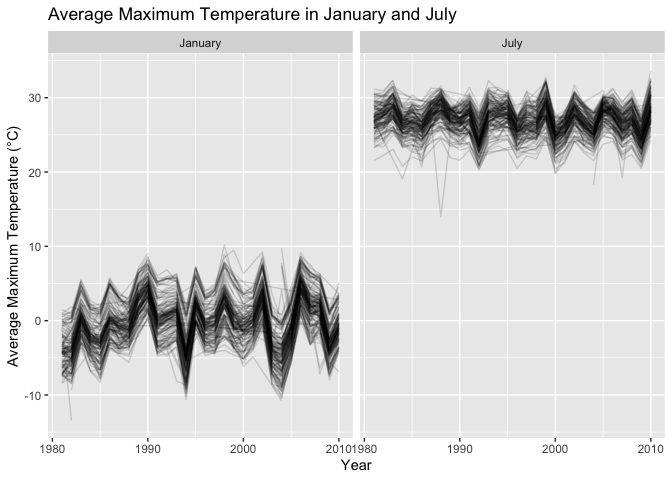
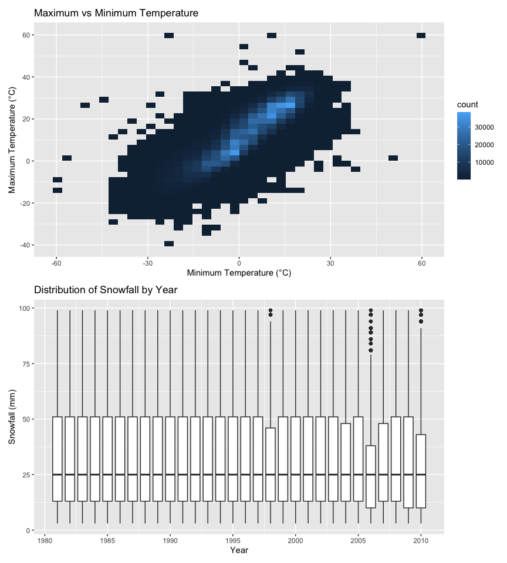

Homework 3
================
Ruichen Yang
2026-10-19

## Problem 1

``` r
data("ny_noaa")

dim(ny_noaa)
```

    ## [1] 2595176       7

``` r
names(ny_noaa)
```

    ## [1] "id"   "date" "prcp" "snow" "snwd" "tmax" "tmin"

``` r
head(ny_noaa)
```

    ## # A tibble: 6 × 7
    ##   id          date        prcp  snow  snwd tmax  tmin 
    ##   <chr>       <date>     <int> <int> <int> <chr> <chr>
    ## 1 US1NYAB0001 2007-11-01    NA    NA    NA <NA>  <NA> 
    ## 2 US1NYAB0001 2007-11-02    NA    NA    NA <NA>  <NA> 
    ## 3 US1NYAB0001 2007-11-03    NA    NA    NA <NA>  <NA> 
    ## 4 US1NYAB0001 2007-11-04    NA    NA    NA <NA>  <NA> 
    ## 5 US1NYAB0001 2007-11-05    NA    NA    NA <NA>  <NA> 
    ## 6 US1NYAB0001 2007-11-06    NA    NA    NA <NA>  <NA>

``` r
ny_noaa_clean = ny_noaa |>
  mutate(
    year = lubridate::year(date),
    month = lubridate::month(date),
    day = lubridate::day(date),
    prcp = prcp / 10,
    tmax = as.numeric(tmax) / 10,
    tmin = as.numeric(tmin) / 10
  )

dim(ny_noaa_clean)
```

    ## [1] 2595176      10

``` r
head(ny_noaa_clean)
```

    ## # A tibble: 6 × 10
    ##   id          date        prcp  snow  snwd  tmax  tmin  year month   day
    ##   <chr>       <date>     <dbl> <int> <int> <dbl> <dbl> <dbl> <dbl> <int>
    ## 1 US1NYAB0001 2007-11-01    NA    NA    NA    NA    NA  2007    11     1
    ## 2 US1NYAB0001 2007-11-02    NA    NA    NA    NA    NA  2007    11     2
    ## 3 US1NYAB0001 2007-11-03    NA    NA    NA    NA    NA  2007    11     3
    ## 4 US1NYAB0001 2007-11-04    NA    NA    NA    NA    NA  2007    11     4
    ## 5 US1NYAB0001 2007-11-05    NA    NA    NA    NA    NA  2007    11     5
    ## 6 US1NYAB0001 2007-11-06    NA    NA    NA    NA    NA  2007    11     6

``` r
missing_summary = ny_noaa_clean |>
  summarize(
    across(
      c(prcp, snow, snwd, tmax, tmin),
      ~ mean(is.na(.))
    )
  )

missing_summary
```

    ## # A tibble: 1 × 5
    ##     prcp  snow  snwd  tmax  tmin
    ##    <dbl> <dbl> <dbl> <dbl> <dbl>
    ## 1 0.0562 0.147 0.228 0.437 0.437

``` r
snow_common = ny_noaa_clean |>
  filter(!is.na(snow)) |>
  count(snow, sort = TRUE)

head(snow_common, 10)
```

    ## # A tibble: 10 × 2
    ##     snow       n
    ##    <int>   <int>
    ##  1     0 2008508
    ##  2    25   31022
    ##  3    13   23095
    ##  4    51   18274
    ##  5    76   10173
    ##  6     8    9962
    ##  7     5    9748
    ##  8    38    9197
    ##  9     3    8790
    ## 10   102    6552

The cleaned NOAA dataset contains 2,595,176 observations. The main
variables include station ID, date, precipitation, snowfall, snow depth,
and daily maximum and minimum temperatures. I also created separate
year, month, and day variables and converted precipitation and
temperature to more interpretable units. Missingness varies across
variables: about 5.6% of precipitation values are missing, compared with
14.7% for snowfall, 22.8% for snow depth, and about 43.7% for both
maximum and minimum temperature. The most common snowfall value is 0 mm,
which makes sense because most station-days do not have snowfall. Other
common values include 25, 13, 51, 76, and 102 mm. These values are close
to common snowfall measurements in inches converted to millimeters, such
as 1, 0.5, 2, 3, and 4 inches.

``` r
temp_month_plot = ny_noaa_clean |>
  filter(month %in% c(1, 7)) |>
  mutate(
    month = recode(
      month,
      `1` = "January",
      `7` = "July"
    )
  ) |>
  group_by(id, year, month) |>
  summarize(
    mean_tmax = mean(tmax, na.rm = TRUE),
    .groups = "drop"
  ) |>
  filter(!is.nan(mean_tmax))

ggplot(
  temp_month_plot,
  aes(x = year, y = mean_tmax, group = id)
) +
  geom_line(alpha = 0.15) +
  facet_grid(. ~ month) +
  labs(
    x = "Year",
    y = "Average Maximum Temperature (°C)",
    title = "Average Maximum Temperature in January and July"
  )
```

<!-- -->

The January and July panels show a clear seasonal difference in average
maximum temperature. January temperatures are much lower and also show
more variability across stations and years, while July temperatures are
generally concentrated around the upper 20s °C. I also notice a few
potential outliers, including unusually low January averages and several
July station-year averages that fall well below the main cluster.

``` r
temp_plot = ny_noaa_clean |>
  filter(!is.na(tmin), !is.na(tmax)) |>
  ggplot(aes(x = tmin, y = tmax)) +
  geom_bin_2d(bins = 40) +
  labs(
    x = "Minimum Temperature (°C)",
    y = "Maximum Temperature (°C)",
    title = "Maximum vs Minimum Temperature"
  )
```

``` r
snow_plot = ny_noaa_clean |>
  filter(
    !is.na(snow),
    snow > 0,
    snow < 100
  ) |>
  ggplot(aes(x = year, y = snow, group = year)) +
  geom_boxplot() +
  scale_x_continuous(breaks = seq(1980, 2010, by = 5)) +
  labs(
    x = "Year",
    y = "Snowfall (mm)",
    title = "Distribution of Snowfall by Year"
  )
```

``` r
temp_plot / snow_plot
```

<!-- -->

Maximum and minimum temperatures have a strong positive relationship,
with most observations following a clear diagonal pattern. For snowfall
values between 0 and 100 mm, the yearly distributions are fairly similar
overall, although a few years have somewhat different spreads and high
outliers.
